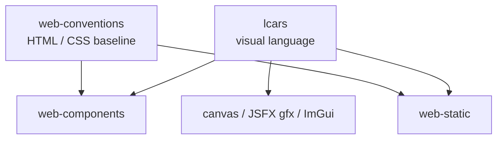

# lcars

Generic, composable design rules for an LCARS-style user interface — the Star Trek TNG computer look. Owns the visual language only: palette and colour roles, condensed typography, the shape vocabulary, layout grammar, states, ordered colour gradients, accessibility, and rendering recipes for CSS and for immediate-mode drawing.

Technology-neutral: a composed stack skill such as [web-components](../../web/web-components) or [web-conventions](../../web/web-conventions) owns markup, component structure, token format and code style. When both specify a rule, the stack skill wins; `lcars` owns the look.

## Composition Model

An LCARS look is usually an alternative theme next to a standard one: layout and behaviour stay identical, only drawing changes.

## Rules at a Glance

| Category | Examples |
|---|---|
| **Principles** | Function first, black ground, flat colour, no borders / shadows / gradients / alpha on shapes, constant black gaps |
| **Palette** | Role-named tokens (`orange`, `peach`, `lilac`, `periwinkle`, `red`, `ice`, `well`, …); at most four frame colours per screen |
| **Ordered colours** | Numbered items on one `orange → peach → lilac → periwinkle` gradient; the label identifies, colour hints |
| **Typography** | Antonio with a condensed fallback chain, upper case at draw time, tabular numbers, missing-font detection |
| **Shapes** | Elbows, bars, column segments, pills, segmented pills, round-ended boxes, caps, readouts; labels bottom-right |
| **Layout** | Elbow frame with title in the top bar, column segments aligned with content sections, 4–6 px gap unit |
| **States** | Inactive, hover, active, destructive, live, selected, attention, disabled — by blending colours, never by transparency |
| **Accessibility** | Contrast pairs, minimum sizes, colour never the only carrier, decorative text hidden from assistive technology |
| **Rendering** | CSS grid frame with radial-gradient cut-outs; immediate mode from filled rectangles and circles in a fixed draw order |

## Scope

- The look: colours, type, shapes, layout, states, motion, and how to draw them
- Excludes component architecture, state management, framework choice and file layout (see the composed stack skill)

## Usage

Triggers on phrases like "LCARS", "Star Trek UI", "TNG look", "Okudagram", "elbow frame", "LCARS theme", or "LCARS mode".

See [SKILL.md](SKILL.md) for the full ruleset and review checklist.
